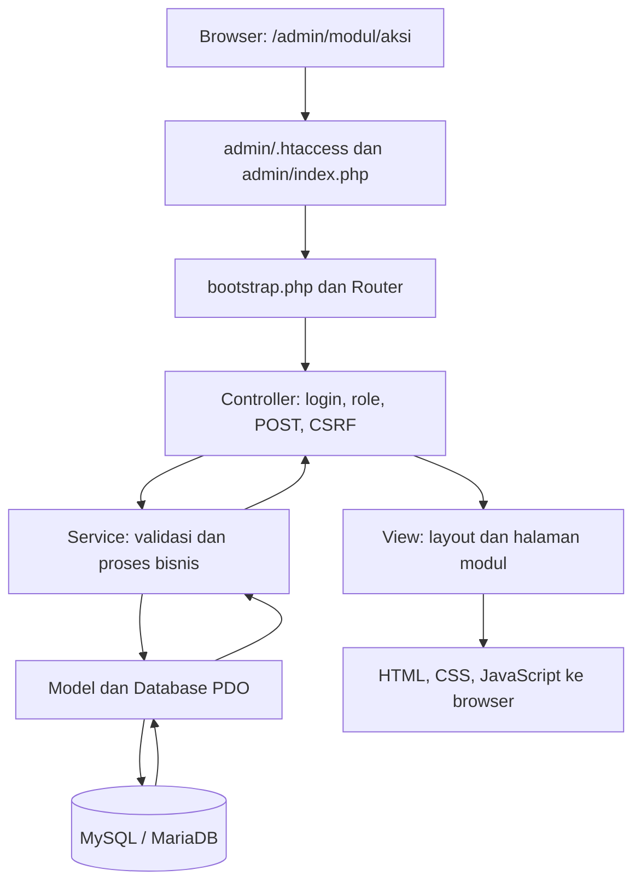

# Struktur proyek dan alur E2E

Diperbarui: 19 Oktober 2026. Jalur di bawah dihitung dari root proyek.

## Struktur saat ini

```text
web-id3/
|-- index.php                 Halaman publik
|-- login.php, logout.php     Entry point autentikasi
|-- .htaccess                 Pembatasan akses folder internal
|-- admin/
|   |-- index.php             Front controller panel
|   `-- .htaccess             Rewrite /admin/{modul}/{aksi}
|-- app/
|   |-- core/                 Bootstrap, Router, Controller, View, Auth, Csrf, Database, helper
|   |-- controllers/          Alur HTTP per modul
|   |-- services/             Validasi dan proses bisnis, ID3, impor, evaluasi
|   `-- models/               Query dan penyimpanan data
|-- views/
|   |-- auth/                 Login dan halaman error
|   |-- admin/                Halaman per modul
|   |-- layouts/              Pembungkus halaman autentikasi dan panel
|   `-- partials/             Dialog, pagination, kepala laporan cetak
|-- assets/
|   |-- css/                  Token dan stylesheet per fitur
|   |-- js/                   JavaScript per fitur
|   |-- img/                  Logo dan gambar WebP yang dipakai situs
|   `-- vendor/fonts/         Font lokal dan lisensinya
|-- config/                   config.example.php dan config.php lokal
|-- database/                 schema.sql, seed.sql, seed_master.sql, migrations/
|-- data/
|   |-- Dataset_Bersih_ID3.xlsx
|   |-- README.md             Peta sumber dan cara membangun ulang
|   |-- sumber/
|   |   |-- man/              Workbook kelulusan, legger/, formulir-tka/
|   |   `-- mas/              legger/, poster-kelulusan/
|   `-- referensi/            Proposal penelitian
|-- scripts/
|   |-- setup_auth.php        Inisialisasi database dan akun awal
|   |-- import_dataset.php    Impor workbook siap pakai
|   |-- proses_penelitian.php Training, evaluasi, aktivasi, prediksi massal
|   `-- penelitian/           build_dataset.py, extract.py, raw_labels.py, match_check.py
|-- tests/                    Tes PHP/Python dan fixture sementara
|-- storage/                  logs/ dan uploads/ saat aplikasi berjalan
|-- output/                   Bukti QA dan manifest lokal; diabaikan Git
|-- docs/                     Panduan, rancangan, verifikasi, archive/
|-- videos/                   siminat-dinamis/ aktif dan archive/ versi sebelumnya
|-- package.json              HyperFrames untuk produksi video
`-- node_modules/             Dependensi lokal perkakas video; diabaikan Git
```

Instalasi web tidak memerlukan Composer atau build Node. `package-lock.json` mengunci dependensi video. Struktur MVC yang sudah berjalan dipertahankan karena autoloader, router, dan renderer memakai letak tersebut.

## Alur permintaan dan data



Halaman publik langsung dirender oleh `index.php` setelah bootstrap. `login.php` dan `logout.php` meneruskan permintaan ke `AuthController`. Controller panel mewarisi `Controller`; operasi khusus admin memanggil `requireAdmin()`, sedangkan perubahan data memeriksa POST dan CSRF. Modul sederhana dapat membaca model langsung; service menangani proses yang membutuhkan logika bisnis. View menerima data tanpa menjalankan query.

| Tahap | File yang bertanggung jawab | Hasil |
|---|---|---|
| Sumber menjadi dataset | `scripts/penelitian/build_dataset.py`, `extract.py`, `raw_labels.py` | Workbook `data/Dataset_Bersih_ID3.xlsx`; lihat [peta sumber](../data/README.md). |
| Inisialisasi | `scripts/setup_auth.php`, `database/` | Database, tabel, akun awal, dan data referensi. |
| Impor | `SiswaController`, `Importer`, `Discretizer`; CLI `scripts/import_dataset.php` | Pratinjau impor di panel, lalu penyimpanan data siswa, nilai, dan atribut. Impor mengganti seluruh data siswa. |
| CRUD siswa | `SiswaController`, `SiswaService`, `Siswa` | Form, draf sesi, tinjauan, penyimpanan dalam transaksi. |
| Diskretisasi | `DiskretisasiController`, `DiskretisasiService`, `Discretizer` | Batas dari database dan kategori atribut siswa. |
| Training | `TrainingController`, `TrainingService`, `Id3`, `ModelId3` | Pohon tersimpan, langkah gain, aturan, dan model aktif. |
| Evaluasi | `PengujianController`, `EvaluasiService`, `Evaluator`, `Evaluasi` | Stratified k-fold, confusion matrix, dan metrik. |
| Prediksi | `PrediksiController`, `PrediksiService`, `Prediksi` | Rekomendasi dari model aktif, jalur keputusan, dan riwayat form/massal. |
| Laporan | `LaporanController`, `views/admin/laporan/`, `TreeImage` | Cetak HTML, CSV siswa/prediksi, dan SVG pohon. |

Controller dimuat melalui daftar modul `Router`, kelas melalui autoloader, dan laporan melalui nama view `cetak-{jenis}`. Referensi dinamis tersebut harus ditelusuri sebelum menyatakan file tidak terpakai.

## Perapian 19 Oktober 2026

- 66 dokumen sumber dipindahkan dari root `data/` ke kelompok sekolah dan jenis dokumennya, termasuk proposal ke `data/referensi/`. Nama dan isi dokumen tetap sama.
- Empat skrip Python dipindahkan ke `scripts/penelitian/`; jalur input/output, perintah README, dan panduan pengembangan disesuaikan.
- Dataset siap impor tetap pada lokasi semula. Aplikasi, database, aset situs, dan proyek video tidak memerlukan pemindahan.
- Direktori `data/` dan `scripts/` tetap berada di bawah aturan penolakan akses HTTP pada `.htaccess` root.
- Manifest sumber, tujuan, dan SHA-256 sebelum pemindahan tersimpan lokal di `output/cleanup-manifest-2026-10-19.json`.

### Verifikasi 19 Oktober

- PASS: 66 hash dokumen sumber identik; 70 lokasi baru ditemukan dan lokasi lama sudah kosong.
- PASS: seluruh 53 foto yang disebut `raw_labels.py` ditemukan pada kelompok sekolahnya; tiga PDF MAN dan delapan workbook MAS tersedia.
- PASS: empat skrip Python lolos pemeriksaan sintaks. Pembacaan sumber dari lokasi baru menghasilkan 196 siswa MAS tanpa selisih total nilai, serta sheet PTKIN `2026` terbaca.
- PASS: dataset siap impor tidak berubah; tes ID3 manual dan verifikasi independen empat skenario lulus.
- PASS: `python -B tests/admin_http_test.py`, mencakup halaman panel, CRUD, training, pengujian, prediksi, impor, laporan, CSRF, dan hak akses.
- PASS: tautan Markdown yang diperbarui valid; lima URL internal, termasuk foto, workbook, proposal, dan skrip di lokasi baru, mengembalikan HTTP 403.
- Pembangunan ulang workbook dari seluruh sumber belum dijalankan karena Poppler `pdftotext` belum tersedia di PATH. Dataset yang ada tetap dipakai; pengujian ini tidak menimpa workbook.

Ringkasan pemeriksaan struktur tersedia lokal di `output/cleanup-verification-2026-10-19.json`. Tes tampilan dan render video tidak diulang karena file antarmuka serta media video tidak dipindahkan.

## Riwayat pembersihan 17 Oktober 2026

Tanggal: 17 Oktober 2026.

### Hasil

- Video sebelumnya dipindahkan dari `videos/siminat-pengenalan/` ke `videos/archive/siminat-pengenalan/`, termasuk source, aset, state editor, dan MP4.
- Delapan catatan iterasi lama dipindahkan ke `docs/archive/iterations/`. Rencana utama, panduan pengembangan, verifikasi metode, dan rancangan landing terbaru tetap di `docs/`.
- Konsep desain dipindahkan dari `docs/visuals/` ke `docs/archive/visuals/`.
- Empat PNG sumber dari `assets/img/` dipindahkan ke `docs/archive/visuals/source/`. Situs tetap menggunakan WebP yang sama pada jalur sebelumnya.
- Dua screenshot pendukung video yang tidak dipakai komposisi dipindahkan dari `assets/` video ke `capture/screenshots/`; script capture diperbarui agar keluaran berikutnya tetap teratur.
- Cache browser Playwright, pytest, bytecode Python, thumbnail, waveform, dan snapshot awal video yang sudah digantikan dihapus. Bukti final video pada `boards/verified/` dan frame hasil decode tetap disimpan.
- MP3 di root dihapus karena hash SHA-256 sama persis dengan musik yang tetap disimpan di kedua proyek video.
- `.gitignore` diperluas agar cache dan state sementara tidak menambah isi repositori pada pekerjaan berikutnya.
- Jalur dataset yang sebelumnya masih mengarah ke root diseragamkan menjadi `data/Dataset_Bersih_ID3.xlsx` pada controller impor, CLI impor, script pembentuk dataset, dan uji verifikasi.

### File yang tetap diperlukan

Controller dimuat secara dinamis oleh router; model dan service melalui autoloader. View laporan menggunakan nama dinamis `cetak-{jenis}`. File tersebut tidak dinyatakan mati hanya karena tidak mempunyai import statis.

Script `extract.py` dan `raw_labels.py` dipakai oleh `build_dataset.py`. `match_check.py` tetap berguna untuk audit pencocokan data penelitian. Dataset, dokumen sumber, upload, konfigurasi lokal, migrasi, pengujian, dan dependensi HyperFrames dipertahankan.

State dan history `.hyperframes/` juga dipertahankan. Folder ini bukan sekadar cache; menghapus semuanya akan menghilangkan konteks penyuntingan video.

### Verifikasi saat pembersihan 17 Oktober

Uji dataset sebelum perbaikan gagal dengan `FileNotFoundError` pada lokasi root. Setelah jalur diperbaiki, empat skenario ID3 lulus: semua data, MAN, MAS, dan tanpa Campuran.

- PASS: lint 98 file PHP dan sintaks script capture JavaScript.
- PASS: `php tests/id3_manual_test.php` dan `python -B tests/verify_id3_dataset.py`.
- PASS: `python -B tests/admin_http_test.py`, termasuk pembacaan dataset dari server, pratinjau impor, pembatalan, CRUD, laporan, autentikasi, dan hak akses.
- PASS: `python -B tests/landing_sections_test.py`, tujuh ukuran layar 360–1920 px, tanpa aset gagal maupun error console.
- PASS: `python -B tests/landing_motion_test.py`, termasuk navigasi, animasi dan reduced motion.
- PASS: 108 referensi aset lokal pada situs dan kedua proyek video ditemukan.
- PASS: 55 media arsip cocok dengan hash Git sebelum pemindahan; tidak ada perubahan isi media.
- PASS: MP4 baru 41,766667 detik dan MP4 lama 45 detik terbaca oleh ffprobe pada lokasi masing-masing.

Sebanyak 146 file dipindahkan dengan struktur internal tetap, 59 file sementara/duplikat terhitung dihapus (3.571.038 byte), dan folder cache pytest yang terkunci dibersihkan terpisah. Angka pemindahan termasuk isi folder proyek video yang kemudian cache-nya dibersihkan.

Manifest perpindahan dan penghapusan tersedia secara lokal di `output/cleanup-manifest.json`. Path lama dan tujuan disimpan agar arsip mudah ditemukan.
